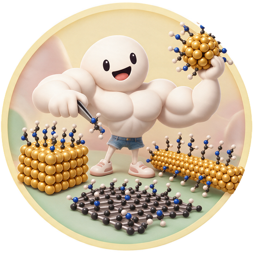

# Buddy Builder (xtalligand): Crystal + Ligand Nanostructure Builder



> **New here (judges, teammates)?** Start with **[GETTING_STARTED.md](GETTING_STARTED.md)**:
> `./setup.sh` then `./start.sh` (Windows: `setup.bat`, `start.bat`), and a five-minute tour,
> including the **Ask Buddy** AI chat that builds and edits models from plain English.

**Buddy Builder** is a Jupyter/ipywidgets tool, intended for nanoHUB, that builds crystalline
nanoparticles, nanorods, slabs and **channels**, and **carbon nanomaterials** (graphene and
graphene oxide with HierGO-style defects, nanotubes, fullerenes and carbon
onions). It attaches ligands given as SMILES or picked from a library (bonded
covalently on carbon) and exports the result as **MD-readable
structure/topology files**: HOOMD-blue (`.gsd`), LAMMPS (`.data`), AMBER and
GROMACS (`.pdb`, and `.mol2` with suggested GAFF2 types), plus extended XYZ and
an explicit `topology.json`.

It implements the hackathon specification in
the team's nanoHUB workflow specification (not included in this repository). What was built, what
changed relative to that document, and what was verified are recorded in
[docs/implementation_log.md](docs/implementation_log.md).

> **Exports are Level B (structure/topology), not simulation-ready.** No force
> field, partial charges or substrate-ligand parameters are generated. Every
> export says so in `README.txt`, `manifest.json` and `validation_report.json`.

## What it does

| Step | Options |
|---|---|
| Material | **Browse materials** hover menu (group, then material) and a type-to-search box (name, word of a name such as "anatase", formula, carbon word). Built-in presets: **Au/FCC (default)**, Ag, Cu, Fe, Si, Mg, Ge, NaCl. A **preloaded Materials Project library** of 30 structures (Pt, Pd, Ni, Al, Co, Ti; AuCu3, AuCu, FePt, CoPt, Ni3Al, CuZn, NiTi, FeAl; TiO2 anatase and rutile, ZnO, Fe3O4, CeO2, MgO, Cu2O, SiO2, Al2O3; CdSe, CdS, ZnS, GaAs, InP, PbS) in `src/nanobuilder/data/materials_project`, read offline (no API key, no network). Or upload a fully ordered **CIF** / POSCAR. Or choose **Carbon nanomaterial**: graphene / graphene oxide sheet, carbon nanotube, or carbon sphere (fullerene or onion). Picking a material shows its **unit cell** (lattice, angles, atoms per cell, volume, density) and previews it in the viewer. |
| Shape & box | Sphere (diameter), **nanorod** (diameter, tip-to-tip length, lattice axis [u v w], hemispherical or flat caps; ligands on side, tips or both), slab with Miller indices (hkl), size, layer count or thickness, and termination, or a **channel**: stacked **slit channels** between slab walls (1-20 channels, a multi-layer channel) or **cylindrical pores** straight through a membrane (1-20 pores, spread evenly over the surface on a golden-ratio pattern, at least 3 atomic spacings from each other and from the box edges; too large or too many pores are reported); ligands go on the channel walls. **Simulation box** (set first): **Rectangular** (x, y, z in nm), **Cube** (one edge; default 8 nm for new builds) or Auto (fit + 3 nm vacuum). The box decides the size: slabs, channels and periodic carbon fill x and y with a whole number of crystal repeats (edge atoms trimmed so the cell repeats exactly; the periodic boundary is moved into the widest gap between atoms, so the cut is clean), z is the box height, and finite models are centred and must fit. Carbon: sheet size, layers (AB/AA); nanotube (n, m), length, walls; fullerene C60·k² or onion shells; finite (H-terminated, AMBER-ready) or periodic. |
| Defects & GO (carbon) | HierGO re-implemented with improvements: vacancies as holes (size classes, random growth or HierGO's hole library), circular pores, Stone-Wales defects, mini grain boundaries (24-atom rotations), ruptures with ether O. Oxidation from 0 to about 68 % O: fresh hydroxyl:epoxy (2:1 default, as in the AMBER GO dataset) or HierGO's aged 600-2500 K profiles (with edge COOH, carbonyl, phenol and ether), or a custom mix; uniform, edges-first, clustered-domain or tiled patterns; face choice. Reports C:O, O %, modified-carbon % and every fallback. See [docs/carbon_materials.md](docs/carbon_materials.md). |
| Ligand | **Library** of common capping agents (alkanethiols, MUA/MPA/MUD, cysteamine, PEG-thiols, amines, citrate, oleate, TPP, TOPO), or any SMILES with the anchor atom picked from a numbered 2D drawing. Chains can be built **all-trans (extended)**. Attachment: **Au-thiolate** (Au/FCC preset; Au-S bond), **Chemisorption** (any crystal: an anchor-surface bond at the sum of covalent radii; S-H and O-H anchors lose their H, N and P keep theirs; thiols on other metals use it), **Physisorption** (no bond; formerly "geometric adsorption"), or **covalent bonds to carbon** (basal sp2→sp3 addition, edge C-H substitution, amide/ester to GO carboxylic acids, epoxide ring-opening; library group "Covalent on carbon"). The ligand list shows only ligands that suit the material. |
| Coverage | Exact ligand count or ligands/nm^2; arrangement **Fibonacci (ordered, default for new builds)**, evenly spaced or random; clash rejection with periodic images. Fibonacci spreads target points on a golden spiral (spheres, fullerenes), a golden-angle helix (rods, nanotubes, pores) or a golden-ratio lattice (flat faces, slit channels) and puts each ligand on the closest free site, so the result is the same on every run. Carbon stacks and nanotubes also offer the **inner** region (between layers, inside the tube). Requested and achieved coverage are both reported. |
| Output | Interactive 3D viewer (rotate, zoom, pan, show/hide ligands, highlight sites, hover for atom details; **click to inspect, measure distances and angles, remove a ligand or add one on a chosen surface atom**, with Undo; Top / Side / Angled / Reset views; orthographic or perspective; **Slice** to look inside; background white, black, theme or transparent; high-resolution PNG (3x); ligand-surface bonds drawn) and a ZIP containing GSD, LAMMPS data + input template, **PDB** (CRYST1, residues, CONECT), extXYZ, `topology.json`, `config.json`, `manifest.json` (SHA-256 of every file), `validation_report.json`, **`session.py`** (Save session: the commands that restore and rebuild this model), **`certificate_of_build.pdf`** (a certificate page with the logo and a picture, then the structure, crystal, atoms, ligand, coverage, topology and validation details and three views), the unit cell used, and the uploaded or Materials Project CIF. Optional **MOL2** with suggested GAFF2 types and GO residues (GRA/OH/EPX/..., or one GRO residue). On slabs, ligands stay whole across the periodic boundary (image flags in LAMMPS/GSD). |
| Size | Up to about 100k substrate atoms by default (a 14 nm Au sphere); see [docs/size_limits.md](docs/size_limits.md). |

## Ask Buddy (AI)

Build and edit by chatting. The **Ask Buddy** panel turns requests into Buddy console commands, for example "a 4 nm gold sphere with 60 dodecanethiol in Fibonacci order, LAMMPS and PDB", then "make it 5 nm", "10 more ligands" or "highlight the sulfur atoms". It tests the commands on a hidden copy of the app, checks the result against what you asked for, and then builds the model in the viewer.

In the Python console:
- **AI** turns plain English into tested commands.
- **Test** dry-runs the commands in the box.
- `ask("...")` plans a request from the console.

Set `BUDDY_LLM_API_KEY` (or `OPENAI_API_KEY`) in `.env` to use a model. Without a key, an offline parser handles the common requests. See [docs/ai_assistant.md](docs/ai_assistant.md).

## Install

Requires **Python 3.12 or newer**: `requirements.txt` pins NumPy 2.5 and SciPy
1.18, which need 3.12 (tested with 3.12.10 on Windows 11). All dependencies
install from PyPI with pip; no compiler is needed.

From this folder (`xtalligand/`):

**Windows (PowerShell)**

First check which Python a plain `python` runs: `python --version`. If Anaconda
is installed, it is often Anaconda's Python (for example 3.11), which is too old
for the pinned packages. Create the environment with an explicit 3.12
interpreter instead:

```powershell
py -3.12 -m venv .venv            # Python from python.org (has the py launcher)
python3.12 -m venv .venv          # or: Python from the Microsoft Store
.venv\Scripts\python -m pip install -r requirements.txt
```

Then call `.venv\Scripts\python` for every command, as below. This avoids
activation scripts and works even while a conda environment is active.

> **If `.venv` already exists, do not re-run `-m venv` with a different
> Python.** That re-points the folder at the new interpreter but leaves the
> compiled packages built for the old one, so imports fail. Delete it first:
> `Remove-Item -Recurse -Force .venv`, then create it again.

**Anaconda / conda (tested on macOS, Apple silicon)**

One conda environment, here called `buddy`, holds everything. Create it once:

```bash
conda create -n buddy python=3.12 -y
conda activate buddy
cd ~/Downloads/xtalligand          # wherever this folder is
python -m pip install -r requirements.txt
```

`pip` inside the activated environment installs into that environment
(`/opt/anaconda3/envs/buddy/...`), not into Anaconda's `base`. Installing
`jupyterlab notebook ipykernel numpy scipy` from conda-forge first is optional:
`pip` then keeps those and adds the rest (ase, rdkit, gsd, spglib, ipywidgets).

With conda, activate the environment in every new terminal
(`conda activate buddy`) and use `python` wherever this README says
`.venv\Scripts\python`.

**macOS / Linux**

```bash
python3.12 -m venv .venv
.venv/bin/python -m pip install -r requirements.txt
```

On macOS/Linux, use `.venv/bin/python` wherever this README says
`.venv\Scripts\python`.

`requirements.txt` pins the exact versions that were tested. The core packages
are `numpy`, `scipy`, `ase`, `rdkit`, `gsd`, `ipywidgets` and `spglib`; `notebook` and
`pytest` are only for local use. Installing the package itself is optional
(`.venv\Scripts\python -m pip install -e .`); the notebook and tests find it in
`src/` without installation.

The 3D viewer loads 3Dmol.js 2.4.2 from cdnjs, so **the web browser needs
internet access**. The Python side works offline (the Materials Project
structures are preloaded).

### Materials Project library

The structures in `src/nanobuilder/data/materials_project` (CIF files plus
`catalog.json`) were exported from Materials Project and are read offline; an
entry whose file is missing is simply not offered. Data CC BY 4.0; cite A.
Jain et al., APL Materials 1, 011002 (2013). To add a structure, drop its CIF
there and add an entry to `catalog.json` (the label is "Group · Name").

## Using Buddy Builder

- **Header**: *Settings* Basic shows the choices most builds need; Advanced adds
  seeds, tolerances, lattice constants and carbon details. *Theme*: Buddy
  (pastel yellow, the default), Buddy 2 (mint green), Light or Dark.
- **Tabs 1-6** are buttons and go in order: Material, Shape (box first, then
  the shape), Defects & GO (carbon), Ligand (only ligands that suit the
  material are listed), Coverage, Export. Main choices are icon buttons; the
  status line always says what is loaded and what to do next.
- **Material tab**: hover **Browse materials** to open a group and click a
  material, or type in **Find material**. The unit cell is shown at once (no
  box or size is needed yet).
- **When a build fails**, sad Buddy pops up for a few seconds with "Oh no!
  Buddy could not build that.", **why** it failed and **how to fix** it (for
  example, a model that does not fit the box, or pores too large for the
  membrane); the same lines stay in Status.
- **Save as** (Export tab) names the downloads: `<name>.zip`,
  `<name>_certificate_of_build.pdf`, `<name>_session.py`. Left empty, Buddy
  makes up a name from a Southern term of endearment, such as
  `Sweet_Pea_Buddy_Au_sphere` or `Hush_Puppy_Buddy_TiO2_pores`.
- **Fonts**: titles, headings, tabs and buttons use Fredoka (bundled in
  `assets/fonts`, SIL Open Font License, so it works offline), other text
  Arial; the Certificate of Build uses the same pair.
- **Save / load a session**: the **Save session (.py)** download (also
  `session.py` in the ZIP) holds the build as console commands plus
  `settings({...})` with every non-default selection, `build()` and any hand
  edits. Paste it into the console, or use **Load session** (also accepts a
  `config.json`), to get the same selections and model back.
- **Certificate of Build (PDF)**: a certificate page (purple border and
  lettering, Buddy, the structure as a transparent picture, atoms, ligands,
  box, and the file name under Buddy's signature), then detail and view pages
  with the poster's awning stripes over a light yellow banner; in every export.
- **Viewer**: the *Click* menu sets what a click does: Inspect atom, Measure
  (two atoms: distance; three: angle), Remove ligand, Add ligand on a surface
  atom. Edits rebuild and re-validate the model, refresh the downloads and are
  listed under **MANUAL EDITS** in the export's `README.txt` (and in
  `config.json` provenance), because the model is then no longer the seeded
  build alone. **Undo edit** steps back.
- **Python console** (under the results): the build as short Python calls,
  for example

  ```python
  material("Au"); box("cube", edge=10); shape("sphere", diameter=4)
  ligand("dodecanethiol"); coverage(count=60, order="fibonacci")
  build()
  select(element="S"); measure(10, 25); remove_ligand(3); undo()
  material("anatase"); box("rectangular", size=(6, 6, 8)); shape("channel", type="pore", width=1.2, count=3)
  session()    # print the commands that rebuild the current model
  ```

  Enter runs the input (Shift+Enter adds a line; a whole saved session can be
  pasted). `help()` lists every command and `help("select")` shows one. Commands drive
  the same widgets as the tabs, and each Generate click is echoed as the
  equivalent commands, so the console doubles as a record. Only the listed
  commands with plain values run (input is parsed, never `eval`-ed).

## Run the GUI

**As an app (one command, no code cells):**

```
./start.sh            # macOS / Linux   (Windows: start.bat)
python start.py       # any platform; --port 9000, --no-browser, --notebook
```

This opens Buddy Builder at http://127.0.0.1:8866 as a standalone page. It uses
this folder's `.venv`, serves `BuddyBuilder.ipynb` (the code cell of `app.ipynb`)
with Voila, and falls back to Jupyter Notebook when Voila is not installed.
Press Ctrl+C to stop.

**In Jupyter**, as before:

Start Jupyter **from the project environment**, so the notebook's kernel is
the Python that has the dependencies:

```powershell
.venv\Scripts\python -m notebook app.ipynb
```

With the conda environment (macOS):

```bash
conda activate buddy
cd ~/Downloads/xtalligand
python -m notebook app.ipynb
```

(macOS/Linux with a venv: `.venv/bin/python -m notebook app.ipynb`.) Use `-m notebook`, not
`-m jupyter notebook`: the `jupyter` command looks up its `notebook` subcommand
on `PATH`, so when Anaconda is on `PATH` it starts Anaconda's Jupyter, whose
kernel lacks the dependencies (`No module named 'ase'`). For the same reason,
do not open the notebook from Anaconda Navigator or a global `jupyter`
command. If the import fails, the error names the Python the kernel is running;
it should be the one inside `.venv`.

Jupyter opens the notebook with its code cell not yet run. Run it with
Shift+Enter (or **Run → Run All Cells**); the builder appears below the cell.
On nanoHUB, AppMode runs the cell and hides the code automatically. The
builder opens with Au/FCC, a 3 nm sphere and 12 SCCO ligands. Click **Generate model**, rotate the result in the
viewer, then use the links under **Downloads**. The **Load an example...**
dropdown sets up the five required demo cases (A-E), five carbon examples
(F-J: a GO flake, aged GO with holes and amides, an aryl-grafted nanotube, a C60
amine adduct, epoxide opening on a periodic GO sheet) and two Buddy Builder
examples (K: Au(111) slit channels with ligands on the walls; L: a 4 nm Au
sphere with 60 dodecanethiols in Fibonacci order in a cubic box); example E uses the
bundled fixture `examples/fixtures/mg_hcp_fully_occupied.cif` as if it had been
uploaded.

On nanoHUB the same notebook is launched in AppMode by `middleware/invoke`
(see [docs/deployment_notes.md](docs/deployment_notes.md)).

### Troubleshooting

| Symptom | Cause | Fix |
|---|---|---|
| `ModuleNotFoundError: No module named 'ase'` in the notebook, kernel shown as `anaconda3\python.exe` | Anaconda's Jupyter is running (started by Navigator, a global `jupyter`, or `python -m jupyter notebook` with Anaconda on `PATH`) | Press Ctrl+C in that terminal to stop it, close its browser tab without saving, then run `.venv\Scripts\python -m notebook app.ipynb` |
| NumPy error mentioning `cp312` files and `cpython-311`, or `DLL load failed while importing _zmq` | `.venv` was re-created over itself with a different Python | `Remove-Item -Recurse -Force .venv`, then repeat the install with Python 3.12 |
| `No matching distribution found for numpy==2.5.4` (or SciPy) | Python older than 3.12 | Install Python 3.12 and create the environment with it |
| 3D viewer shows "3Dmol.js could not be loaded" | The browser cannot reach cdnjs.cloudflare.com | Allow internet access for the browser |
| Terminal shows `Error while saving file: ... xtalligand/Downloads/xtalligand/app.ipynb` or `Kernel does not exist` | A browser tab from an earlier Jupyter server (started in another folder) is still open and autosaving | Close every old Jupyter tab, then open the `http://localhost:8888/...` link that the new server prints |
| New options (for example **Carbon nanomaterial**) are missing after updating the code | The kernel still has the old code loaded | **Kernel → Restart**, then run the cell again |

## Run without the GUI

The command-line tool needs the package on the import path. Either install it
once (`.venv\Scripts\python -m pip install -e .`) or set `PYTHONPATH` in the
same terminal (PowerShell: `$env:PYTHONPATH = "src"`; bash: `export PYTHONPATH=src`).

```powershell
.venv\Scripts\python -m nanobuilder.cli examples/au_sphere_12ligands.json --out build
```

Carbon builds need no extra input:

```powershell
.venv\Scripts\python -m nanobuilder.cli examples/graphene_oxide_flake.json --out build
```

Configs that use an uploaded crystal need the file:

```powershell
.venv\Scripts\python -m nanobuilder.cli examples/uploaded_crystal_slab.json --crystal examples/fixtures/mg_hcp_fully_occupied.cif --out build
```

A `config.json` from any exported ZIP rebuilds the same model (same seed, same
atoms).

## Test

```powershell
.venv\Scripts\python -m pytest
```

(macOS/Linux: `.venv/bin/python` in place of `.venv\Scripts\python`.)

212 tests cover the specification's acceptance matrix: presets and the Au/FCC
default, CIF happy and failure paths, sphere/slab geometry and Miller normals,
SMILES and the thiolate edit, the Au-thiolate availability rule, site
detection, counts/density/clash/periodic images, topology, GSD and LAMMPS
round trips, all twelve examples end to end, the CLI, and the GUI driven
headlessly. The carbon tests check lattices, vacancy and oxygen accuracy, ring
statistics of Stone-Wales and 24-atom defects, AMBER GO metrics (C:O, modified
carbon %), every covalent template, valences and contacts, and the MOL2, PDB and
LAMMPS exports. One more test runs a real LAMMPS `read_data` check when the
environment variable `LAMMPS_EXE` points to a working LAMMPS executable; it is
skipped otherwise.

## Layout

```text
xtalligand/
  app.ipynb               GUI entry point (one cell)
  middleware/invoke       nanoHUB launcher (illustrative; verify on nanoHUB)
  src/Makefile            nanoHUB build/install hooks (copies the package to lib/python)
  src/nanobuilder/
    schema.py             configuration and model contracts shared by all modules
    material_presets.json preset registry (Au_fcc is the default)
    crystal.py            presets -> CrystalModel        importers.py  CIF/POSCAR upload checks
    materials_project.py  live MP search + structures    material_catalog.py  grouped picker entries
    shapes.py             spheres, rods, slabs           cell.py       boxes, image flags, whole molecules
    carbon.py             carbon substrate build, typing, attachment sites
    carbon_lattice.py     bond-graph network, graphene/CNT/fullerene lattices, edge clean-up
    carbon_defects.py     holes, pores, Stone-Wales, 24-atom rotations, ruptures, relaxation
    carbon_oxidation.py   oxygen groups, profiles, patterns (HierGO decorate-tile)
    atomtypes.py          suggested GAFF2 / OPLS types   gui_carbon.py carbon widgets
    ligands.py            SMILES -> 3D ligand (RDKit)    chemistry.py  attachment templates (Au-thiolate, carbon)
    ligand_library.py     common capping agents
    sites.py              exposed on-top sites           placement.py  coverage, orientation, clashes
    topology.py           canonical AssemblyModel        validation.py checks before export
    exporter_gsd.py  exporter_lammps.py  exporter_pdb.py  exporter_mol2.py  exporter_generic.py
    reporting.py          ZIP, manifest, READMEs
    pipeline.py           one call per GUI action        cli.py        command-line runs
    gui.py  viewer.py     ipywidgets GUI (Buddy Builder) and 3Dmol.js viewer (click tools, edits)
    console.py            Python-vocabulary console      editing.py    remove / add ligands after Generate
    fibonacci.py          ordered (Fibonacci) placement targets
    theme.py              Buddy / Buddy 2 / light / dark stylesheet; assets/ holds the logos
    mp_library.py         preloaded Materials Project structures (data/materials_project)
    session.py            Save session (session.py)    certificate.py  Certificate of Build PDF
    examples.py           the twelve demo configurations (A-E crystals, F-J carbon, K-L Buddy)
  tests/                  pytest suite
  examples/               demo configs (JSON) and fixtures/ (one valid HCP CIF, three invalid CIFs)
  tools/benchmark_sizes.py  size/time/memory benchmark
  docs/                   implementation log, scientific assumptions, MD export notes,
                          deployment notes, size limits, collaboration handoffs,
                          carbon_materials.md (carbon builder reference)
  HierGO-master/          HierGO reference (GPL-3.0; papers, scripts, HoleLibrary read at run time)
```

## Limitations

- Alloys come only as Materials Project lists them (ordered compounds such as
  AuCu3, FePt, NiTi); random solid solutions are not generated.
- Chains are not tilted, so dense SAM coverages (about 4.6/nm^2 on Au(111))
  are not reached; carboxylates and P/O ligands bind through one atom.

- Starting geometries only: nothing is energy-minimized, and RDKit/MMFF
  optimizes the isolated ligand, not the interface.
- On-top sites only on metals and crystals; one ligand species per build.
  Bonded templates: Au-thiolate, generic chemisorption (one anchor-surface bond, no
  reviewed chemistry) and the four covalent carbon templates.
- Carbon: suggested GAFF2 types for ligand atoms are provisional; only the
  outermost wall or shell of multi-wall tubes and onions is oxidized, and
  ligands go on the outer wall or (region Inner) the innermost wall; ligands
  between graphene layers need a layer spacing larger than the ligand; very high O % targets on small flakes can fall slightly
  short; AMBER cannot use bonds across a periodic boundary (build finite flakes
  for AMBER). Details in [docs/carbon_materials.md](docs/carbon_materials.md).
- Channels are cut from one slab orientation: slit walls are parallel to the
  slab, cylindrical pores go straight through it (along z). Periodic x and y
  lengths are whole numbers of crystal repeats, so they can differ slightly
  from the box you type (the build reports the actual cell).
- Viewer clicks reach the app through the notebook page (Jupyter, AppMode,
  Voila); if a page blocks that, use `remove_ligand()` / `add_ligand()` in
  the console. The viewer loads 3Dmol.js from cdnjs, so the browser needs
  internet access.
- Uploaded crystals must be fully ordered; the cell is used as given (no
  symmetry standardization), and Miller indices refer to that cell.
- Type labels such as `Au_sub`, `S_anchor` and `C` are structural labels, not
  force-field types. LAMMPS charges are `q = 0` placeholders.

See [docs/scientific_assumptions.md](docs/scientific_assumptions.md),
[docs/md_export_notes.md](docs/md_export_notes.md) and
[docs/carbon_materials.md](docs/carbon_materials.md).

## License

Not chosen yet; see [LICENSE](LICENSE). The team must pick one before
publishing on nanoHUB.

The `HierGO-master/` reference folder is GPL-3.0 (Garcia et al., 2023). The
carbon builder re-implements its algorithms and does not copy its code; the
HierGO hole library is read from that folder at run time and is not bundled into
the package or exports. Remove or relocate the folder, or set
`NANOBUILDER_HOLE_LIBRARY`, as your license choice requires.
