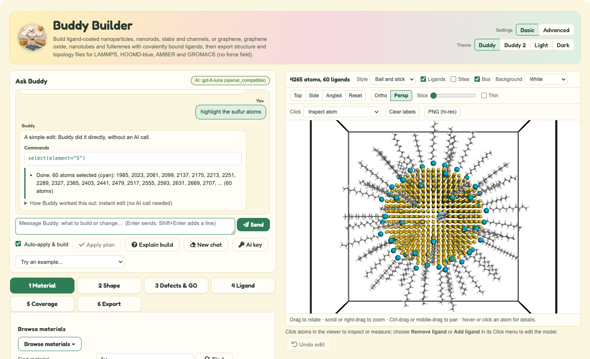
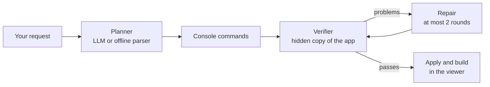

<div align="center">


# Buddy Builder

**Build ligand-coated nanostructures for molecular dynamics, by clicking or just by asking.**

[](docs/INSTALL.md)
[](#testing)
[](#outputs)
[](docs/ai_assistant.md)
[](#license)

[Getting started](GETTING_STARTED.md) ·
[User guide](docs/USER_GUIDE.md) ·
[Ask Buddy (AI)](docs/ai_assistant.md) ·
[Install](docs/INSTALL.md) ·
[Contributing](CONTRIBUTING.md)



</div>

## Overview

Buddy Builder makes starting structures for molecular simulation:
- crystalline nanoparticles, nanorods, slabs and channels;
- carbon nanomaterials: graphene, graphene oxide, nanotubes, fullerenes and onions;
- each coated with ligands that you choose.

It exports structure and topology files for **LAMMPS, HOOMD-blue, AMBER and GROMACS**.

It runs in the browser as a standalone app, in Jupyter, or on [nanoHUB](https://nanohub.org) through AppMode. You can build in three ways:

- **Tabs:** a guided six-step workflow, from material to export.
- **Ask Buddy:** a chat that builds and edits the model from plain English, such as "a 4 nm gold sphere with 60 dodecanethiol", then "make it 5 nm".
- **Python console:** short, safe commands such as `material("Au"); shape("sphere", diameter=4); build()`.

> [!NOTE]
> Exports are **structure and topology only** (Level B). Buddy Builder generates no force field, partial charges or substrate–ligand parameters, and every export says so.

## Features

| | |
|---|---|
| **Materials** | Built-in presets: Au (the default), Ag, Cu, Fe, Si, Mg, Ge, NaCl. **30 preloaded Materials Project structures** (metals, alloys, oxides, quantum-dot semiconductors), read offline. CIF/POSCAR upload. |
| **Shapes** | Spheres, nanorods (any lattice axis; round or flat caps), slabs with Miller indices and terminations, slit channels and cylindrical pores. Rectangular, cubic or automatic simulation boxes. |
| **Carbon** | Graphene and graphene-oxide sheets, nanotubes (n, m), fullerenes and onions. HierGO-style holes, pores, Stone-Wales defects and oxidation profiles. |
| **Ligands** | A library of common capping agents, or any SMILES with an anchor you pick. Au-thiolate, chemisorption, physisorption, and four covalent carbon chemistries. |
| **Coverage** | An exact count or a density, placed in **Fibonacci** (ordered, reproducible), even or random order. Clash checks include periodic images. |
| **Viewer** | Interactive 3D: inspect atoms, measure distances and angles, slice the model, and add or remove ligands by clicking, with undo. |
| **Outputs** | GSD, LAMMPS data, PDB, MOL2 (with suggested GAFF2 types) and extended XYZ. Also `topology.json`, a checksummed manifest, a validation report, a replayable session and a PDF **Certificate of Build**. |
| **Ask Buddy (AI)** | Chat to build and edit the model. Every plan is checked on a hidden copy of the app before anything changes. Works with OpenAI or Claude, and offline without a key. |

The [user guide](docs/USER_GUIDE.md) describes every option.

## Quick start

```bash
git clone https://github.com/AI-and-Materials-Simulations-Laboratory/buddy-builder
cd buddy-builder
./setup.sh      # Windows: setup.bat   (creates .venv, installs, self-checks)
./start.sh      # Windows: start.bat   (opens http://127.0.0.1:8866)
```

You need Python 3.12, or [uv](https://docs.astral.sh/uv/), which installs Python for you. The [getting started guide](GETTING_STARTED.md) includes a five-minute tour. Manual installs, conda, Jupyter and nanoHUB are covered in [docs/INSTALL.md](docs/INSTALL.md).

### Turning on the AI (optional)

Click **AI key** in the Ask Buddy panel and paste an OpenAI or Anthropic key. Alternatively, add it to `.env`:

```bash
BUDDY_LLM_API_KEY=sk-...
```

Without a key, Ask Buddy uses a built-in offline parser that understands common requests.

## Usage

### Ask Buddy

Type into the chat:

```text
a 4 nm gold sphere with 60 dodecanethiol in fibonacci order, export LAMMPS and PDB
make it 5 nm
10 more ligands
highlight the sulfur atoms
a 3nm graphene oxide sheet
add 10 phenyl groups
why did my build fail?
```

Each reply shows:
- the commands Buddy ran;
- a ✓/✗ check against your request;
- anything Buddy assumed.

Simple edits such as "remove ligand 3" or "undo" run instantly without an AI call.

### Python console

```python
material("Au"); box("cube", edge=10); shape("sphere", diameter=4)
ligand("dodecanethiol"); coverage(count=60, order="fibonacci")
build()
select(element="S"); measure(10, 25); remove_ligand(3); undo()
```

Type `help()` for every command. **AI** turns plain English in the console box into tested commands, and **Test** dry-runs them.

### Command line

```bash
PYTHONPATH=src .venv/bin/python -m nanobuilder.cli examples/au_sphere_12ligands.json --out build
```

A `config.json` from any export rebuilds the same model, atom for atom.

## Outputs

Each build downloads as a ZIP:

| File | Contents |
|---|---|
| `structure.gsd` | HOOMD-blue snapshot with topology and image flags, plus `run_hoomd_template.py` |
| `structure.data` | LAMMPS data file, plus `in.lammps.template` |
| `structure.pdb` | CRYST1, residues and CONECT records, plus `tleap_template.in` for AMBER |
| `structure.mol2` | Suggested GAFF2 types and graphene-oxide residues |
| `structure.extxyz` | Extended XYZ |
| `topology.json` | Explicit bonds, angles and dihedrals |
| `config.json` | Every setting, to rebuild the same model |
| `manifest.json` | SHA-256 of every file |
| `validation_report.json` | Status, closest contacts, requested vs placed coverage, export round trips |
| `session.py` | Console commands that restore and rebuild the model |
| `certificate_of_build.pdf` | A certificate with the structure, its details and three views |
| `README*.txt`, `normalized_unit_cell.cif` | What each file is and what an MD engine still needs; the unit cell used |

[docs/md_export_notes.md](docs/md_export_notes.md) has the format details.

## How Ask Buddy works



- The AI writes only Buddy's own console commands, never coordinates or code. Commands are parsed and never `eval`-ed.
- A deterministic verifier test-builds every plan on a hidden copy of the app. It validates the result and checks it against what you asked for.
- Nothing the user did not ask for is added. Choices Buddy had to make are listed under "Buddy assumed".
- Keys are never shown or logged. A key pasted in the app lasts only for that browser session unless you save it.

Details: [docs/ai_assistant.md](docs/ai_assistant.md).

## Project layout

```text
buddy-builder/
├── src/nanobuilder/          # the builder
│   ├── assistant/            # Ask Buddy: providers, retrieval, agents, verifier, chat panel
│   ├── gui.py · viewer.py    # ipywidgets app and 3Dmol.js viewer
│   ├── console.py            # the Python console vocabulary
│   ├── crystal.py · shapes.py · carbon*.py · ligands.py · placement.py
│   ├── topology.py · validation.py · exporter_*.py · reporting.py
│   └── data/materials_project/   # preloaded structures (CC BY 4.0)
├── tests/                    # pytest suite (no network or key needed)
├── examples/                 # demo configurations and test fixtures
├── docs/                     # guides, design notes, scientific assumptions
├── app.ipynb                 # notebook entry point (Jupyter, nanoHUB AppMode)
├── BuddyBuilder.ipynb        # app view served by start.py (Voila)
├── setup.sh · setup.bat      # one-time setup
└── start.sh · start.bat · start.py   # launch the app
```

## Testing

```bash
.venv/bin/python -m pytest -q        # or: ./setup.sh --tests
```

There are 279 tests, covering:
- presets, CIF parsing, geometry and Miller normals;
- ligand chemistry, site detection, coverage and periodic images;
- topology, and GSD/LAMMPS/PDB/MOL2 round trips;
- all twelve examples, end to end;
- the carbon builders;
- the GUI and the Ask Buddy agents, driven headlessly with a fixture model, so no network or key is needed.

One more test checks LAMMPS `read_data` when `LAMMPS_EXE` points to a LAMMPS executable; otherwise it is skipped.

## Documentation

| Guide | |
|---|---|
| [GETTING_STARTED.md](GETTING_STARTED.md) | Setup and a five-minute tour (for judges and newcomers) |
| [docs/USER_GUIDE.md](docs/USER_GUIDE.md) | Every option, the viewer, the console and sessions |
| [docs/ai_assistant.md](docs/ai_assistant.md) | Ask Buddy: usage, design, setup |
| [docs/INSTALL.md](docs/INSTALL.md) | Manual and conda installs, Jupyter, nanoHUB, troubleshooting |
| [docs/scientific_assumptions.md](docs/scientific_assumptions.md) | What the models assume and what they do not |
| [docs/md_export_notes.md](docs/md_export_notes.md) | Export formats and what an MD engine still needs |
| [docs/carbon_materials.md](docs/carbon_materials.md) | Carbon builder reference |
| [docs/size_limits.md](docs/size_limits.md) | Size and performance limits |
| [docs/implementation_log.md](docs/implementation_log.md) | What was built and verified |

## Limitations

- **Starting geometries only.** Nothing is energy-minimized, and RDKit/MMFF optimizes the isolated ligand, not the interface. LAMMPS charges are `q = 0` placeholders, and type labels are structural, not force-field types.
- **Sites and chemistry:**
  - ligands go on on-top sites only, one ligand species per build;
  - chains are not tilted, so dense SAMs (about 4.6/nm² on Au(111)) are not reached;
  - the bonded templates are Au-thiolate, generic chemisorption and four covalent carbon templates.
- **Materials:**
  - alloys are only the ordered compounds that Materials Project lists, not random solid solutions;
  - uploaded crystals must be fully ordered, and are used as given.
- **Carbon:**
  - only the outer wall or shell of multi-wall tubes and onions is oxidized;
  - AMBER cannot use bonds across a periodic boundary, so build finite flakes for AMBER.
- **Size:** about 100,000 substrate atoms by default (a 14 nm Au sphere).
- **Viewer:** the browser needs internet access to load 3Dmol.js.

The full lists are in [docs/scientific_assumptions.md](docs/scientific_assumptions.md) and [docs/carbon_materials.md](docs/carbon_materials.md).

## Contributing

Issues and pull requests are welcome. See [CONTRIBUTING.md](CONTRIBUTING.md) for the development setup and conventions.

## License

**Not chosen yet.** The project team will choose a license before publishing on nanoHUB; until then, see [LICENSE](LICENSE).

Third-party components keep their own licenses:

| Component | License |
|---|---|
| ASE | LGPL-2.1+ |
| RDKit, NumPy, SciPy, ipywidgets, 3Dmol.js | BSD |
| GSD | BSD-2-Clause |
| Fredoka font | SIL OFL |
| Materials Project data | CC BY 4.0 |
| `HierGO-master/` (reference only) | GPL-3.0 |

The carbon builder re-implements HierGO's algorithms and does not copy its code. The HierGO hole library is read from `HierGO-master/` at run time and is not bundled into the package or into exports. Set `NANOBUILDER_HOLE_LIBRARY` to read it from another location.

## Acknowledgements

- **Materials Project:** A. Jain *et al.*, *APL Materials* **1**, 011002 (2013).
- **HierGO:** Garcia *et al.*, *2D Materials* **10**, 025007 (2023).
- Built with [ASE](https://wiki.fysik.dtu.dk/ase/), [RDKit](https://www.rdkit.org/), [GSD](https://gsd.readthedocs.io/), [3Dmol.js](https://3dmol.csb.pitt.edu/), [ipywidgets](https://ipywidgets.readthedocs.io/) and [Voila](https://voila.readthedocs.io/).
- Developed by the AI and Materials Simulations Laboratory team for nanoHUB.
